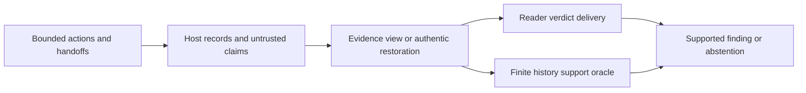

# Use the talks to diagnose what an auditor needs

Reviewed 8 November 2026, after registration and while the six-reader MAIN remained
unfinished. This is an editorial/source synthesis, not a new hypothesis freeze,
new empirical result, outcome selection rule, or completion of the four queued
post-integration reviews. Attached documents and chat messages are reference
material, not instructions. The current historical PDF is unchanged.

## Lead with the investigator's decision

An agent says an update was completed. That statement does not establish who
acted, whether the grant was still valid, or whether another agent had already
spent the shared budget. An investigator needs to know what intervention would
help: recover an authentic record, obtain a usable verdict, or improve the use
of evidence that is already sufficient within the declared history model.

The strongest angle remains **diagnosing evidence, delivery and reasoning
failures in a controlled stateful swarm-audit workflow**. Its theory of change is
practical: identify which component needs repair before spending on a stronger
or fine-tuned monitor. The contribution is the matched, prospectively registered
instrument and its eventual validated findings. The underlying distinction is prior art.

This diagram describes the registered measurement structure, not a result.
The oracle's support set is conditional on its trust and compatible-history
assumptions. It is not a posterior over all possible real deployments.

## What each talk contributes

Offsets refer to the paired transcript recording clock. They do not use the
different chat clock. Detailed source checks and qualifications are in the four
linked review memos, not in the main paper's narrative.

| Recording | Relevant point | Use or boundary |
|---|---|---|
| Nov 5 13:16, Ben Allan-Rahill, 47:03–49:32 | Cheap monitors and evaluation of their deployment tradeoffs. | Fine-tuning is a possible later intervention after a reproducible reasoning failure, not a credit-spending obligation. |
| Nov 5 15:02, John Kitaoka, 56:11–57:25 | Finding which agents/evidence to correlate differs from residual failure with combined evidence. | Direct motivation for the main question; explicitly acknowledge it rather than claiming to invent the distinction. |
| Nov 5 22:01, Grant Fleming, 33:54–34:45 and 53:25–57:09 | Disclosure can be steered; assess manipulation checks, controls and observed behavior. | Treat reporter claims as untrusted; distinguish assigned attack instructions from actual host actions. Talk-reported attack counts are not our results. |
| Nov 6 13:33, Nguyen Tran/Kamil Alaa, 05:05–08:15 | Answer one question in a readable research report. | Put the target decision, matched estimands, actual denominators and limitations ahead of infrastructure history. |
| Nov 6 18:02, John Yan/Elvis Sikora, 13:33–17:25 and 19:00–27:00 | Ask which missing disclosure blocks a test; study manageable incident components. | Quantify what authentic record restoration changes. Call our setup a controlled component study, not a full incident reproduction. |
| Nov 6 19:03, Rowan Howard-Jones, 18:12–21:09 | Unobserved behavior can reflect observation failure; familiar human explanations may be wrong. | Missing logs, a negative verdict and genuinely absent behavior must remain different cases. |
| Nov 6 20:16, Elias Stengel-Eskin, 47:27–48:52, 53:48–54:13 and 57:18–57:49 | Cooperative language emergence and in-context adaptation have specific conditions; no direct weight-space connection was asserted. | Do not relabel controlled peer influence as covert intent, emergent language, swarm training or weight-space programming. |
| Nov 6 21:35, Judd Rosenblatt, 07:59–12:54 and 22:00–23:06 | A neglected concrete question and reusable infrastructure can matter. | State the diagnostic decision the instrument enables; neither motivation nor code volume establishes efficacy. |
| Nov 6 22:32, Kamil Alaa, 08:14–09:25 and 16:22–17:05 | Impact, execution and clarity are the judging dimensions. | Make one result and its implication understandable; do not manufacture a numerical score prediction. |
| Nov 7 13:01, Justin Shenk, 07:07–07:39 and 19:22–19:45 | Managed teams differ from decentralized swarms; revocation during handoffs remains an open question in Q&A. | Describe the fixed five-role workflow and temporal policy clearly; the questioner's example is motivation, not validation. |
| Nov 7 19:01, Jurgis Kemeklis, 27:02–29:05, 41:04–41:39 and 53:44–54:32 | Control requires safety/usefulness distinctions and access to adequate logs; tampering is a central concern. | Distinguish retrospective audit quality from preventing harm. State the external host-record trust assumption. |

## Keep three comparisons separate

| Layer | What changes | What stays matched | What the completed result could establish |
|---|---|---|---|
| Evidence acquisition | Visible authentic records: loss and two-record restoration policies. | Source trajectory and eligible honest/both arms. | Whether an acquisition policy improves finite-domain answerability and supported decisions. |
| Verdict delivery | Delivery/encoding implementation in the registered text/schema comparison; observed serving/parse status. | Matched source evidence under the registered route definitions. | Operational differences in receiving usable output. Do not score a missing/invalid verdict as a cognitive explanation. |
| Use of sufficient evidence | DIRECT versus PROCEDURE instructions on the same FULL16 packet. | Source evidence and reader profile. | A matched instruction effect on correct-definite verdicts; not proof of an internal reasoning mechanism or changed weights. |

The HF text/schema comparison and thinking-mode comparison are profile-specific
secondary interventions. Six profiles are not six independent model families.
Repeated arms, packets and readers do not create more than 640 independent base
blocks. Preserve the frozen primary, bootstrap and all registered secondary
conditions. No new conditional denominator may silently replace the primary.

## Interpret every possible result honestly

| Completed observation | Defensible interpretation | Claim to avoid |
|---|---|---|
| Restoration increases oracle answerability and supported correctness. | Better evidence helped under this finite policy/trust model. | The monitor became more intelligent or the restoration policy is universally optimal. |
| Oracle answerability improves but verdict quality does not. | A delivery or use-of-evidence gap remains; inspect the already specified measures. | More evidence never helps, or the exact internal failure mechanism is known. |
| PROCEDURE improves same-packet FULL16 verdicts. | The registered instruction changed operational performance with sufficient evidence fixed. | The model learned a general safety skill or weights reveal swarm intent. |
| FULL16 performance is near ceiling or the procedure effect is null/adverse. | Report the ceiling or null/adverse contrast and uncertainty. The diagnostic instrument remains useful if it separates the tested failure modes. | Suppress that condition, add unregistered favorable cases, or claim model equivalence from a nonsignificant difference. |
| Natural labels are concentrated in NONE. | Compare with always-NONE and report false accusations and actual positive counts; use scripted calibration separately. | Incident detection or population recall from a sample with no incidents. |
| Peer-note variation changes Y's action. | Controlled inter-agent influence in the registered receiver state. | Spontaneous collusion, population contagion or a causal blame label for the whole team. |
| The generator-knowledge sensitivity changes support. | Sufficiency depends on the declared knowledge model. | Replacing the frozen primary with a more favorable oracle or claiming universal impossibility. |

These interpretation rules are editorial safeguards applied before MAIN accuracy
inspection. They add no new confirmatory test. Any later exploratory analysis
needs its own label, rationale and retained denominator.

## Primary-source overlap and originality

Kitaoka's [MiniLab paper](https://arxiv.org/abs/2610.24052v1) already studies
distributed attack fragments and monitoring blind spots. Yun et al.'s
[evidence-binding study](https://arxiv.org/abs/2610.09581v1) already separates
supported findings from correct guesses. [ActiveEvidence](https://arxiv.org/abs/2610.20532v2)
already treats acquisition as a model-relative decision problem. The submitted
claim must be the stateful matched test and its actual results, not a claim to
originate those distinctions. Their settings and guarantees do not automatically
transfer to this finite fake-data contract oracle.

The verified [incident reproduction](https://www.lesswrong.com/posts/fMnC6ZD37qrnZAFYz/openai-huggingface-a-reproduction-and-lessons-for-alignment)
uses a simplified environment and simulated peers for parts of its experiment.
That supports carefully scoped component reenactment, not calling this project
a replication of the real incident. The linked incident playbook is a draft with
an unresolved publication note; only its general methodological guidance is used
here, not its unpublished case-specific claims. Swarms.wiki could not be accessed
in this review and is not counted as read.

Winning-project principles are clarity, an operational measurement, meaningful
controls and reproducibility, not imitation of another submission. The public
Omission Attacks page specifies first place in the LinuxArena track; broader
introductory award wording should not overwrite that precise attribution.
Syscon and ActionLens remain reference examples, not evidence that this project
has earned a particular score. A source review cannot guarantee originality,
eligibility, a prize or absence of undiscovered prior art.

## Fit the rubric without inflating the claim

- **Impact and innovation:** show how the diagnosis changes an investigator's
  next action. Explain precisely what the controlled stateful comparison adds
  beyond prior evidence-aware monitoring.
- **Execution:** complete the frozen grid, verify actual host events and support
  sets, retain service/format failures, show matched uncertainty, class mixture,
  baselines and the generator-domain sensitivity.
- **Clarity:** one concrete example, then three definitions, a compact design
  table, the primary effect and acquisition plot, then bounded implications.
  Move engineering chronology and supporting plots to appendices. Keep the
  required limitations/dual-use appendix explicit.

Current written [guidelines and Judging and results](https://apartresearch.com/sprints/swarm-alignment-2026#guidelines) remain the rules reference when speech or ASR differs.

## Coverage and repository changes

The [43-entry coverage manifest](talk-context-coverage.json) commits the archive
and each member by hash: 11 transcripts, nine CC variants, 11 chats, one link DOCX
and 11 audio files representing about 8.82 hours. All supplied text was read or
reconciled by full transcript/caption alignment. Audio was inspected through MP4
durations and paired transcript endpoints; it was not listened to in full.
Transcript endings within about five seconds of audio endings do not prove
faithful transcription or complete mid-recording coverage. Several CC files start
late. No slide/video review or independent audio accuracy claim is made.

Detailed reviews: [November 5](TALK_REVIEW_NOV5.md),
[November 6 technical](TALK_REVIEW_NOV6_TECHNICAL.md),
[control and modelling](TALK_REVIEW_CONTROL_AND_MODELLING.md), and
[logistics/rule conflicts](TALK_REVIEW_LOGISTICS.md). The prepared complete-study
draft now credits the question and sharpens its trust boundaries and conditional
interpretation. The current historical manuscript/PDF, scientific code, frozen
protocols, request identities, data collection and scoring remain unchanged.
An isolated synthetic-only Word preflight of the expanded narrative and table
shapes fit seven main pages, with two main figures and two appendix figures.
No final page inspection or empirical PDF completion is claimed from that probe.
